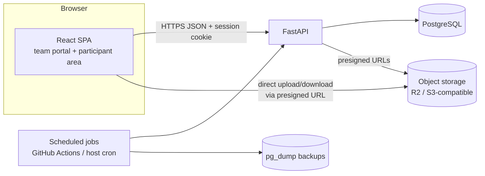

# 01 — Architecture

## 1. System overview



- There is **one backend and one database** for every module. When the Treasurer records a transaction, the Chairperson's dashboard reads the same rows (blueprint §10.4).
- **The SPA serves two audiences.** Team members use `/app/*` and participants use `/` and `/me/*`. Both talk to the same API, and the backend decides what each user can see.
- **Files never pass through the API.** The API checks permission, records the metadata and issues a short-lived presigned URL. The browser then uploads or downloads directly. This keeps the free-tier backend's bandwidth and memory low.
- **There are no AI services and no paid APIs at runtime.**

## 2. Repository layout (monorepo)

```
/
├─ backend/
│  ├─ app/
│  │  ├─ main.py               # app factory, middleware, router mounting
│  │  ├─ core/                 # config, db session, security, errors, pagination
│  │  ├─ auth/                 # login, logout, sessions, password change
│  │  ├─ users/                # accounts, profiles, lifecycle
│  │  ├─ org/                  # departments, positions, assignments, org chart
│  │  ├─ permissions/          # catalogue, roles, grants, check engine
│  │  ├─ audit/                # audit_events writer + viewer
│  │  ├─ tasks/
│  │  ├─ events/
│  │  ├─ documents/
│  │  ├─ points/
│  │  ├─ finance/
│  │  ├─ membership/
│  │  ├─ participants/         # public listing, registration, participant area
│  │  ├─ attendance/           # attendance + certificate records
│  │  ├─ comms/                # announcements, meetings, campaigns, notifications
│  │  ├─ reports/              # dashboards, exports
│  │  └─ settings/             # org-wide configurable settings
│  ├─ migrations/              # Alembic
│  ├─ tests/
│  └─ pyproject.toml
├─ frontend/
│  ├─ src/
│  │  ├─ api/                  # typed client (generated from OpenAPI)
│  │  ├─ auth/                 # session context, route guards
│  │  ├─ components/           # shared UI
│  │  ├─ features/<module>/    # one folder per backend module
│  │  ├─ layouts/              # AppLayout (team), PublicLayout (participants)
│  │  └─ routes.tsx
│  └─ package.json
├─ docs/
├─ docker-compose.yml          # postgres (+ minio for local object storage)
└─ .github/workflows/          # ci.yml, backup.yml
```

Each backend module contains `router.py` (HTTP layer), `service.py` (business rules and transactions), `models.py` (SQLAlchemy) and `schemas.py` (Pydantic). Routers stay thin, and business rules such as "only approved points reach the ledger" live in services.

## 3. Request flow and authorisation

```
Request ─► CORS / security headers ─► rate limiter ─► session middleware
        ─► CSRF check (state-changing methods)
        ─► route dependency: current_user()      → 401 if no valid session
        ─► route dependency: require(perm, scope) → 403 if not permitted
        ─► service function (single DB transaction)
             ├─ business validation
             ├─ write rows
             └─ audit.record(...)  (same transaction)
        ─► response
```

- `require("finance.view", scope=Scope.finance_account(account_id))` is a FastAPI dependency. Every protected endpoint declares one, and a CI test fails the build if any `/api/*` route other than the public allowlist lacks a `require` dependency.
- List endpoints also apply **row filtering** in the query. For example, a Lead listing tasks only gets the tasks of departments they hold `tasks.view` on. See [02-permissions.md](02-permissions.md) §5.
- The audit write shares the business write's transaction, so neither can succeed without the other.

## 4. Authentication (custom, inside FastAPI)

| Concern | Design |
|---|---|
| Password storage | Argon2id (`argon2-cffi`) with tuned memory and time cost. Raw passwords are never stored or logged. |
| Account creation | Only admins with `users.create` can create accounts. There is no public signup for team roles. |
| Initial credentials | The admin creates the user with status `invited`, issued either as a **one-time invite link** (token stored as a SHA-256 hash, expires after 72 hours) or a **temporary password**, with `must_change_password = true`. |
| Account statuses | `invited`, `active`, `suspended`, `deactivated`. The first successful login with a password change moves `invited` to `active`. |
| Forgotten password | An admin resets it manually by setting a new temporary password, and `must_change_password` is set again. There is no email reset flow. The action is audited and the password is never logged. |
| Self password change | Available to any logged-in user and requires the current password. All other sessions are revoked afterwards. |
| Sessions | Server-side `sessions` table. The browser holds a 256-bit opaque token in an `HttpOnly; Secure; SameSite=Lax` cookie, and the DB stores only its hash. Idle timeout is 2 hours and absolute timeout is 7 days (configurable). Logout deletes the row. |
| Suspend / deactivate | Revokes every session for that user immediately. |
| CSRF | Double-submit token: a non-HttpOnly cookie plus an `X-CSRF-Token` header on POST, PUT, PATCH and DELETE. |
| Rate limiting | Login is limited per IP and per account, e.g. 5 failures in 15 minutes triggers a 15-minute lockout. Counters live in Postgres, so no Redis is needed. |
| MFA | Optional TOTP is planned for after Phase 8. The `user_mfa` table is reserved now. |
| Participants | `user_type = 'participant'`. They can self-register only when the `participants.self_registration` setting is on. They never receive team permissions. |

The Chairperson account is created by a one-off CLI command (`python -m app.cli create-superadmin`) and is never created through the web.

## 5. Frontend

- **Routing:** `PublicLayout` covers event listing, event detail, registration, login and the participant area. `AppLayout` covers the team portal, with a sidebar built from the user's effective permissions.
- **`/api/auth/me`** returns the user, their positions and a flattened list of effective permission codes with scopes. The UI uses this list **only** to show or hide controls. The backend re-checks every request.
- **Data fetching** uses TanStack Query. API types live in `src/api/types.ts` and mirror the Pydantic schemas. They can be switched to generated types (`openapi-typescript` against `/api/openapi.json`) once the API grows.
- **Forms** use React Hook Form with Zod schemas that mirror the Pydantic schemas.
- **Charts** use Recharts for leaderboards, trends and finance summaries.
- **Responsive design** is mobile-first with Tailwind. Tables collapse into cards on narrow screens.

## 6. Cross-cutting concerns

| Concern | Approach |
|---|---|
| Validation | Pydantic on every input, DB constraints as a second line of defence |
| Errors | Uniform JSON `{error: {code, message, details}}` responses |
| Pagination | Cursor-based on long lists (audit, ledger, registrations) |
| Time | All timestamps stored as `timestamptz` in UTC and displayed in IST |
| Money | `numeric(12,2)` in INR, never float |
| IDs | `bigint` identity PKs internally. Human-readable codes (`EXP-2026-0042`, `MEM-0153`) come from per-type sequences. |
| Soft deletion | Organisational records are archived, not deleted. Ledgers are append-only (see [03-data-model.md](03-data-model.md)). |
| Files | Allowed MIME list and size cap set in settings. Files are stored under a random key, and the original name is kept as metadata. |
| Exports | CSV export is permission-gated (`*.export`) and every export is audited |
| Notifications | `notifications` table, read by polling every 60 seconds. Email is optional, only through a configured free-tier provider, and limited to plain template text. |
| Secrets | Environment variables only. `.env` is git-ignored and `.env.example` is committed. |
| Testing | pytest with a real Postgres in CI (service container). Permission tests are table-driven per endpoint. |

## 7. Environments

| Env | Database | Files | Notes |
|---|---|---|---|
| Local | Postgres 17 in Docker | MinIO in Docker | `docker compose up`, then `uvicorn` and `vite` |
| Staging | Free-tier Postgres branch | R2 bucket `-staging` | Deployed automatically from `main` |
| Production | Free-tier managed Postgres | R2 bucket | Deployed from tagged releases. Backups nightly. |

See [08-free-tier-hosting.md](08-free-tier-hosting.md) for provider choices.
