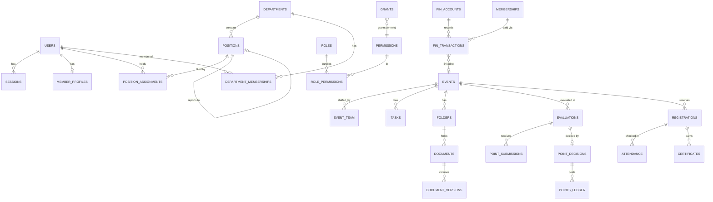

# 03 — Data Model

The full DDL draft is in [04-schema.sql](04-schema.sql). This document explains the shape of the model and the rules it must never break.

## 1. Core invariants

1. **History is never lost** (blueprint §18). Positions, department membership and reporting lines are **effective-dated** (`valid_from`, `valid_to`). A change closes the current row and opens a new one, and existing rows are never edited. This keeps "who was Ops Lead during TechFest 2026" answerable forever.
2. **Ledgers are append-only.** No UPDATE or DELETE is allowed on `points_ledger` or on `finance_transactions` once a transaction is posted, and DB triggers enforce this. Corrections go in as new adjustment or reversal rows that reference the original.
3. **Book balance is derived.** `balance = opening_balance + Σ(posted credits) − Σ(posted debits)`, computed by a view and never stored. A bank balance is shown as *reconciled* only for periods that have a reconciliation record (blueprint §10).
4. **Only approved points count.** A ledger row exists only when a `point_decision` with outcome `approved` or `adjusted` exists.
5. **Files are versioned.** Replacing a document adds a `document_versions` row. Deleting one sets `deleted_at` and `deleted_by`, writes to the audit log and leaves the object in storage until the retention period ends.
6. **Everything important is audited** in `audit_events` (append-only, trigger-protected).

## 2. Entity overview



## 3. Record groups (blueprint §18)

### Identity & access
- `users`: email (unique, case-insensitive), `password_hash`, `user_type` (`team`/`participant`), `status` (`invited`/`active`/`suspended`/`deactivated`), `must_change_password`, `is_super_admin`, `created_by`, plus failed-login counters.
- `invite_tokens`: hashed one-time token with an expiry.
- `sessions`: hashed token, created and last-seen timestamps, IP and user agent.
- `permissions`, `roles`, `role_permissions`, `grants`, `permission_audit`. See [02-permissions.md](02-permissions.md).

### Organisation
- `terms`: academic or committee terms (e.g. 2026–27), used for history and leaderboards.
- `departments`: name, description, status (`active`/`archived`), parent department (optional).
- `positions`: title, department, `reports_to_position_id`, `is_lead`, `is_deputy`, `max_holders`. A position with no current assignment shows as **vacant** on the org chart.
- `position_assignments`: user × position, effective-dated, with a reason (`appointed`, `promoted`, `transferred`, `resigned`, `removed`).
- `department_memberships`: user × department, effective-dated.
- `member_profiles`: UID, phone, branch, year, joining date, lifecycle status (`onboarding`/`probation`/`active`/`alumni`/`removed`), responsibilities.

### Work
- `tasks`: title, description, priority, due date, status, `department_id?`, `event_id?`, `reviewer_id`, `created_by`.
- `task_assignees`, `task_dependencies`, `task_comments`, `task_submissions` (evidence: text, link or file), `task_status_history`.
- **Overdue** is computed (`due_at < now()` and the task is not completed) rather than stored, so it never goes stale.

### Events
- `events`: name, category, description, venue, start and end, registration window, capacity, status (Draft → … → Archived), `owner_id`, budget.
- `event_departments`, `event_team` (user, role on the event, effective-dated), `event_milestones`, `event_checklist_items`, `event_status_history`.

### Documents
- `folders`: tree via `parent_id`, `event_id?`, `sort_order`. `folder_templates` seeds the nine default event folders (01 Proposal … 09 Final Report).
- `documents`: title, category, description, folder, status, `current_version_id`.
- `document_versions`: storage key, original filename, MIME type, size, SHA-256 checksum, uploader, timestamp.
- `document_reviews`: status change, remarks, reviewer, approval reference.

### Performance
- `evaluator_map`: evaluator (user or position) → evaluatee (user, position or department), optionally per term.
- `evaluations`: one per (event, evaluatee), with `max_points` and a status (`open`/`submitted`/`decided`).
- `point_submissions`: evaluator, score, max, remarks, evidence document. Returned submissions are revised as new rows.
- `point_decisions`: Chairperson outcome (`approved`/`adjusted`/`rejected`/`returned`), final score, reason.
- `points_ledger`: append-only, recording user, event, points, the decision or adjustment that produced it, and the term.

### Finance
- `fin_accounts`: name (Main Society, Membership Fund, Event Fund, Sponsorship Fund …), opening balance and date, active flag.
- `fin_transactions`: human code, type (`income`/`expense`/`transfer_in`/`transfer_out`/`adjustment`/`reversal`), amount (always positive, with the direction implied by type), account, date, source or payee, purpose, category, payment mode and reference, links (`event_id`, `department_id`, `membership_id`, `sponsor_id`), `transfer_group_id`, `reverses_id`, status (`submitted` → `verified` → `approved` → `posted`; also `rejected`, `reimbursed`), `submitted_by`, `verified_by`, `approved_by`.
- `fin_attachments`: bills, receipts and proofs.
- `fin_reconciliations`: account, period, statement balance, book balance, difference, reconciled by.
- `sponsors`: name, contact, linked events.

### Membership
- `membership_categories`: name and fee.
- `memberships`: member (user or external person), membership ID, category, fee, status (`pending`/`paid`/`waived`/`refunded`/`cancelled`), valid from and to, proof. A payment creates a linked `fin_transactions` income row.

### Participants
- `registration_forms`: per event, as JSON field definitions plus consent text.
- `registrations`: event, participant user (optional when account-less registration is allowed), team name, answers (JSONB), UID and email (unique per event), status (`submitted`/`approved`/`rejected`/`waitlisted`/`cancelled`), unique registration code.
- `registration_team_members`.
- `attendance`: registration (or team member), checked-in time, method (`manual`/`qr`), recorded by.
- `attendance_corrections`: append-only.
- `certificates`: registration, uploaded file, issued flag.

### Communication
- `announcements` (audience scope), `meetings` (agenda, minutes document), `campaigns` and `campaign_posts` (platform, planned date, status, post link, proof file), `notifications` (user, type, payload, read_at).

### Governance
- `audit_events`: actor, action, entity type and ID, before and after (JSONB), IP, timestamp.
- `settings`: key → JSONB value. Approval workflows, file limits and the points formula are stored here.
- `exports_log` and `backups_log`.

## 4. Configurable approval workflows

Steps are not hard-coded. A workflow is stored in `settings`:

```json
{
  "finance.expense": {
    "steps": [
      {"name": "verify",  "permission": "finance.expense.verify"},
      {"name": "approve", "permission": "finance.expense.approve",
       "threshold_rules": [{"amount_gt": 5000, "require_super_admin": true}]}
    ],
    "post_on_final_step": true
  }
}
```

Services read this configuration to work out which step comes next and who may act on it. The rules in [02-permissions.md](02-permissions.md) §6 still apply: a person cannot approve their own submission, and the chain cannot be skipped.
