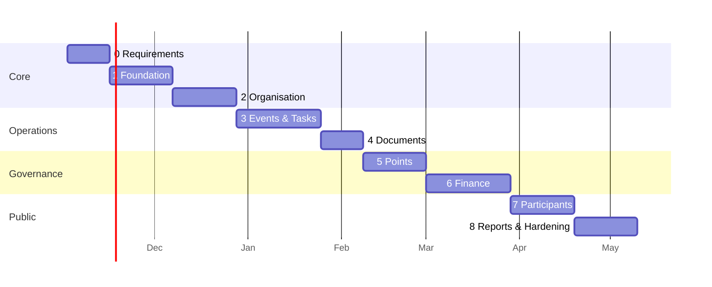

# 06 — Development Roadmap

This roadmap follows blueprint §20. Each phase is built, tested and deployed to staging before the next one starts. Effort estimates assume 2–3 part-time student developers and are rough guides only.

---

## Phase 0 — Requirements sign-off (≈2 weeks)
- Work through [07-open-decisions.md](07-open-decisions.md) with the Chairperson. Accept or change each recommended default.
- Fill in the real org chart: departments, positions and reporting lines.
- Agree the initial permission grants, using [02-permissions.md](02-permissions.md) §8 as the starting point.
- Set up a GitHub repo, a branch protection rule on `main`, and a project board with one milestone per phase.

**Exit:** the decisions document is signed off and the repo exists.

## Phase 1 — Foundation (≈3 weeks) ✅ built

> **Status (2026-10-31):** Phase 1 is implemented and passes 31 backend tests plus the frontend type-check and build. Differences from the plan below:
> - The API types are hand-written in `frontend/src/api/types.ts` rather than generated from OpenAPI.
> - Only `global` scope can be granted until Phase 2 adds departments.
> - Grants to positions and departments arrive in Phase 2.

**Backend**
1. Scaffold the `backend/` directory with FastAPI, SQLAlchemy 2.0 (async optional; sync is fine at this scale), Alembic, pydantic-settings and pytest. Add `docker-compose.yml` with Postgres 17 and MinIO.
2. Add `core/`: config, DB session per request, uniform error handler, security headers, CORS.
3. Write migration `0001`: `users`, `invite_tokens`, `sessions`, `login_attempts`, `permissions`, `roles`, `role_permissions`, `grants`, `permission_audit`, `audit_events`, `settings`, and the `forbid_mutation()` triggers.
4. Build the auth module: Argon2id hashing; login and logout; session middleware with idle and absolute expiry; CSRF; rate limiting and lockout; change password; accept invite; the `must_change_password` gate.
5. Add the `create-superadmin` CLI command.
6. Users module: create a user with an invite link or temporary password, list, edit, suspend, reactivate, deactivate, and admin password reset. Every action is audited.
7. Permissions engine: the permission catalogue seeded from code; `can()`, `require()` and `visible_scope_ids()`; the grants API with the anti-escalation rules; `permission_audit` writes.
8. Audit module: an `audit.record()` helper and an audit list endpoint.
9. A CI test that fails if any non-public route lacks a `require` dependency.

**Frontend**
1. Scaffold Vite, React, TypeScript, Tailwind and React Router. Generate the API client from OpenAPI.
2. Login, forced password change, accept invite, logout.
3. `AppLayout` with a permission-aware sidebar. Every route is protected.
4. Admin screens: user list, create user (with invite link or temporary password), user detail (status actions, reset password), and grants editor.
5. Audit log viewer.

**Tests:** auth flows, lockout, session expiry, CSRF, each anti-escalation rule, and one table-driven permission test per endpoint.

**Exit:** the Chairperson can log in, create an account, grant a scoped permission and see it audited. The new user can log in, is forced to change their password, and only sees what was granted. A suspended user is logged out at once.

## Phase 2 — Organisation (≈3 weeks) ✅ built

> **Status (2026-10-31):** Phase 2 is implemented. There are 44 backend tests in total. Notes on what was built:
> - Grants can go to users, positions or departments, scoped globally or to a department. A department scope also covers its sub-departments.
> - Org endpoints use `require_any()` as a coarse gate, then `engine.ensure()` checks the exact department. List endpoints filter rows through `visible_department_ids()`.
> - `python -m app.cli seed-org` loads the leadership chain and the nine departments from blueprint §4.2.
- Migration: `terms`, `departments`, `positions`, `position_assignments`, `department_memberships`, `member_profiles`.
- Services: create, rename and archive departments (archiving is blocked while open assignments exist unless they are moved first); create positions and set `reports_to`; assign, transfer, promote or end a position (closing the effective-dated row); lifecycle status.
- The grant check now resolves position and department grants.
- UI: departments page, positions page, member profile with designation history, and an interactive org chart that shows vacant positions (built with an off-the-shelf React tree component or an SVG).
- **Exit:** the real org chart is entered. Moving a member out of a Lead position immediately removes the Lead's scoped access. Their history still shows the former role.

## Phase 3 — Events & Tasks (≈4 weeks) ✅ built

> **Status (2026-11-01):** Phase 3 is implemented (migration `0003`, 64 backend tests, plus a browser walkthrough of every journey). Decisions and differences from the plan below:
> - **Approval chain (decided with the Chairperson):** Draft → Proposed (Leadership reviews with the new `events.review` permission) → Awaiting approval → the Chairperson approves (`events.approve`). Reviewers and approvers can send an event back with a reason, and nobody reviews or approves an event they own.
> - **Who proposes events:** every core team member, for their own department (the Member role now includes `events.create`). Department Leads also get `events.edit`.
> - Event owners run their own event (team, checklist, milestones, tasks) without extra grants. Assignees, reviewers and event owners always see their tasks.
> - Task evidence is a note and/or a link for now; file uploads arrive with Documents (Phase 4).
> - There is no background scheduler on the free hosting plan, so "due soon" reminders are created when a person next checks their notifications.
> - Existing installs run `python -m app.cli sync-defaults` once to pick up the new default permissions and grants.
- Migrations for events and tasks (sections 3 and 4 of the schema).
- Event state machine with allowed transitions and the permission each one needs. Every transition writes `event_status_history`.
- Event workspace UI with tabs: Overview · Team · Tasks · Checklist & Milestones · Documents (Phase 4) · Registrations (Phase 7) · Finance (Phase 6) · Points (Phase 5).
- Tasks: create, multi-assign, dependencies, status flow, submissions with evidence, reviewer feedback, comments, a computed overdue state, "My tasks" and department boards.
- Notifications table and polling: task assigned, task due soon (nightly job), task reviewed.
- **Exit:** a full event can be created and approved, staffed and tasked, and members can submit work that their Lead reviews.

## Phase 4 — Documents (≈2 weeks) ✅ built

> **Status (2026-11-01):** Phase 4 is implemented (migrations `0007` and `0008`, `app/documents`). It needs file storage settings in production; see [09-deployment.md](09-deployment.md). Differences from the plan below:
> - **Uploads go through the backend** instead of presigned PUT URLs, so no bucket CORS setup is needed and the server checks the type, size and SHA-256 itself. Downloads and previews use short-lived presigned GET links.
> - The starting folders are a constant in `app/documents/folders.py`, not a `folder_templates` table, and folders are one level deep. The `files` table is not built, so task evidence is still a note and/or a link.
> - An event's owner and team can view and upload in its folders without extra grants. Forum folders (no event) need the permission globally. Nobody reviews their own upload, except the Chairperson.
> - Deleted documents stay in storage indefinitely: the 90-day purge is not built because the free plan has no scheduler.
>
> **Also added:** team members complete their profile (University ID, official email, current block, branch, year, phone, and an optional IETE membership ID) after first sign-in, and the dashboard has a calendar of events and the person's open tasks.
- Migrations: `folder_templates`, `folders`, `documents`, `document_versions`, `document_reviews`, `files`.
- Storage adapter (S3 API with presigned PUT and GET), working against MinIO locally and R2 in production. MIME and size validation. The SHA-256 is computed by the client and verified on commit.
- Event folders are auto-created from the templates when an event is created.
- Upload, replace (new version), review status, soft delete, search and filter, and preview (PDF and images in the browser).
- **Exit:** Workflow 19.5 works end to end. A document deleted by a member with permission is still visible in the audit log, and its versions are kept.

> **Reporting lines (2026-11-01):** the Chairperson can add a lead or a category from the org chart and delete any box, even while it is held (migration `0010`). A category groups positions and nobody holds it. Deleted positions keep their row as `deleted`, so history still names them; the Chairperson's own position can't be deleted. A new department Lead position gets the Department Lead role.

## Phase 5 — Points (≈3 weeks) ✅ built as score cards

> **Status (2026-11-01):** the Chairperson replaced the per-event design below with **score cards** (migration `0006`, `app/scores`). The Chairperson opens a scoring round whenever they choose; everyone except the Chairperson gets a card worth up to 20, filled in by fixed scorers (`app/scores/rules.py`):
> - Member: Lead 5, Secretary 5, Vice Chair 5, Chairperson 5
> - Department Lead: Joint Secretary 5, Secretary 5, Vice Chair 5, Chairperson 5
> - Joint Secretary: Secretary 7, Vice Chair 7, Chairperson 6
> - Vice Chairperson: Secretary 10, Chairperson 10 · Secretary: Vice Chair 10, Chairperson 10
>
> Scores stay private while a round is open (the Chairperson sees all); closing it publishes every card to the whole team. Totals add up across rounds (20, 40, …) and feed promotion and demotion decisions, which the Chairperson makes in Organisation. The Chairperson can delete one round or reset all scores to start again from zero (migration `0011`); the rows stay marked `deleted`, and the audit log records the reason. The per-event evaluations, evaluator map and ledger below are not built.
- Migrations: `evaluator_map`, `evaluations`, `point_submissions`, `point_decisions`, `points_ledger`.
- Evaluator map editor. Opening evaluations for an event. The evaluator inbox. Submitting with a score, maximum, remarks and evidence.
- Chairperson review screen showing every submission per evaluatee, the combined total (using the configured mode), and approve, adjust, reject or return.
- Ledger posting, adjustments that record old score, new score and reason, and leaderboards (overall, department, event, month, semester, term) with Recharts trend charts.
- **Exit:** Workflow 19.3 works end to end. The 10 + 8 = 18/30 example from blueprint §9.2 reproduces. The DB rejects any attempt to UPDATE the ledger.

## Phase 6 — Finance & Membership (≈4 weeks)
- Migrations: section 8 and section 7 of the schema.
- Accounts with opening balances. Income recording. The expense workflow driven by the `finance.expense` setting. Linked transfers. Reversals. Attachments. The balance view.
- Membership categories and records. A paid membership creates a linked income transaction. Summary counts.
- Reconciliation screen comparing the statement balance with the book balance. Balances are labelled **Book balance** and are marked *Reconciled up to <date>* only when a reconciliation exists.
- Notifications: expense awaiting verification or approval.
- **Exit:** Workflow 19.4 works end to end. A submitter cannot verify or approve their own expense (enforced in both the API and the DB). A posted transaction cannot be edited or deleted.

## Phase 7 — Participants (≈3 weeks)
- Migrations: section 9 of the schema.
- Public event pages. A form builder for event owners (field types: text, email, phone, select, checkbox, file). Consent text.
- Registration: individual or team, duplicate email and UID checks, capacity and waitlist, deadlines, unique registration code, review queue.
- Participant area: my registrations, status and certificates (only released ones are visible).
- Attendance: bulk manual marking, and QR check-in by scanning the registration code with the phone camera in-browser using the `html5-qrcode` library. Corrections are logged.
- Certificate upload, either bulk or one per registration.
- **Exit:** a participant can register, be approved, be checked in by QR and download their certificate. Registration exports are permission-gated and logged.

## Phase 8 — Reports & Hardening (≈3 weeks)
- Chairperson dashboard and module reports (blueprint §14), filterable and exportable to CSV.
- "Missing event records" check: completed events with empty mandatory folders.
- Promotions campaign calendar and announcements/meetings, if not already done.
- Security pass: OWASP checklist, dependency audit (`pip-audit`, `npm audit`), rate limits on all public endpoints, upload content sniffing, CSP headers.
- Backups: a nightly `pg_dump` to separate storage, a documented restore procedure, and **one test restore**.
- Load sanity check with expected volumes. Privacy notice. Data retention settings.
- Production deployment and handover documentation for the next committee.
- **Exit:** every item in the blueprint §22 Definition of Done is checked.

---

## Traceability — blueprint → design

| Blueprint section | Where it is covered |
|---|---|
| §3 Users, auth | 01-architecture §4 · schema §1 · Phase 1 |
| §4 Hierarchy | 03-data-model §3 Organisation · Phase 2 |
| §5 Permissions | 02-permissions · Phase 1–2 |
| §6 Tasks | schema §4 · API Tasks · Phase 3 |
| §7 Events | schema §3 · API Events · Phase 3 |
| §8 Documents | schema §5 · API Documents · Phase 4 |
| §9 Points | schema §6 · API Points · Phase 5 |
| §10 Finance, membership | schema §7–8 · 03-data-model §4 · Phase 6 |
| §11 Participants | schema §9 · Phase 7 |
| §12 Comms & notifications | schema §10 · Phase 3 (notifications), Phase 8 (campaigns) |
| §13 Attendance & certificates | schema §9 · Phase 7 |
| §14 Reports | API Reports · Phase 8 |
| §15 Security & audit | 01-architecture §3–6 · 02-permissions §6–7 · Phase 1, 8 |
| §16 No AI | Constraint across all docs. No AI dependency anywhere. |
| §17 Tech, free-first | README · 08-free-tier-hosting |
| §18 Data architecture | 03-data-model · 04-schema.sql |
| §19.1–19.5 Workflows | Exit criteria of Phases 2, 3, 5, 6 and 4 respectively |
| §21 Decisions | 07-open-decisions |
| §22 Definition of done | Phase 8 exit |
